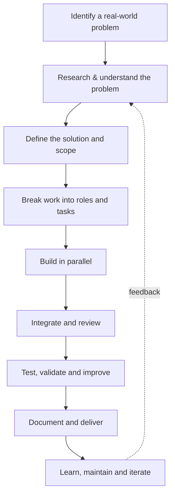

<!-- Replace HACKCARTEL with the exact GitHub organization username if it differs. -->

<h3>We turn real-world problems into working products.</h3>

  

  
  
  
  

---

## ` who_we_are `

**HackCartel is a builder-led technology community** bringing together people with different skills to identify meaningful problems, develop practical solutions, and turn ideas into usable products.

We work around problem statements and real-world challenges—not just technology for its own sake. Every initiative is divided into clear areas of ownership so that members can contribute, take responsibility, and move the work forward together.

We are building a community where people learn by doing, collaborate across disciplines, experiment with emerging technology, and take ideas beyond the brainstorming stage.

> **Our principle:** A good idea is only the beginning. We organise, build, test, improve, and deliver.

## ` what_we_do `

<table>
  <tr>
    <td width="50%">
      <h3>🧩 Problem → Product</h3>
      Start with a real need or problem statement. Research it, understand the users, define the scope, and build a practical solution.
    </td>
    <td width="50%">
      <h3>🤖 Applied AI & Research</h3>
      Explore AI, machine learning, LLMs, intelligent automation, and emerging technologies through practical implementations.
    </td>
  </tr>
  <tr>
    <td width="50%">
      <h3>⚙️ Engineering & Development</h3>
      Build the foundations: frontend, backend, APIs, databases, integrations, infrastructure, and deployment.
    </td>
    <td width="50%">
      <h3>🏁 Hackathons & Experiments</h3>
      Work under constraints, collaborate across roles, validate ideas quickly, and learn through building.
    </td>
  </tr>
  <tr>
    <td width="50%">
      <h3>🔬 Innovation & Prototyping</h3>
      Test concepts, build proof-of-concepts, evaluate results, and iterate based on evidence.
    </td>
    <td width="50%">
      <h3>🌐 Community & Open Source</h3>
      Share knowledge, document our work, contribute to useful projects, and create opportunities for others to build.
    </td>
  </tr>
</table>

## ` how_we_work `

Our workflow is designed to make ownership clear and contributions measurable.

### Shared mission. Clear ownership.

Each project is divided into responsibilities. Members own their assigned areas while collaborating with the rest of the team.

| Workstream | Core responsibility |
|---|---|
| **Project & Product** | Problem definition, requirements, priorities, milestones, and coordination |
| **Research & AI** | Research, datasets, model exploration, AI features, and evaluation |
| **Backend & Systems** | APIs, application logic, integrations, databases, and infrastructure |
| **Frontend & Experience** | Interfaces, user flows, accessibility, and product experience |
| **Quality & Validation** | Testing, debugging, verification, and reliability checks |
| **Documentation & Community** | Technical write-ups, project updates, knowledge sharing, and community operations |

*Roles can vary by project. Members may collaborate across workstreams, but every task should have a clear owner.*

## ` areas_of_interest `

  
  
  
  
  
  
  
  

We choose tools based on the problem and the product requirements. Our work can involve Python, JavaScript/TypeScript, React, Node.js, FastAPI, databases, machine-learning frameworks, LLM tooling, and cloud or container technologies.

## ` selected_work `

A snapshot of product-building and applied problem-solving initiatives connected to our team's work.

<table>
  <tr>
    <td width="50%" valign="top">
      <h3>🛍️ Vyapaar Loop</h3>
      <b>Merchant Growth AI</b> 
      A hackathon concept focused on helping small merchants—such as kirana stores and cafés—identify growth opportunities and recover potential revenue through actionable, low-friction workflows.
        
      Focus: Applied AI · Merchant tools · Product workflows
    </td>
    <td width="50%" valign="top">
      <h3>🛡️ AI Code Vulnerability Detector</h3>
      A code-analysis project exploring machine-learning and deep-learning approaches to identify potentially defective or vulnerable code, with a backend API and dashboard interface.
        
      Focus: AI/ML · Code analysis · FastAPI · Developer tools
    </td>
  </tr>
  <tr>
    <td width="50%" valign="top">
      <h3>♻️ CIRCULENS</h3>
      <b>Waste Valorization Intelligence</b> 
      An initiative exploring how data and AI can help SMEs and farmers understand waste streams and discover potential value-recovery opportunities.
        
      Focus: Sustainability · Research · Decision support
    </td>
    <td width="50%" valign="top">
      <h3>🧪 Security Labs & Validation</h3>
      Hands-on cybersecurity learning and validation work involving controlled lab environments, technical documentation, and repeatable testing.
        
      Focus: Cybersecurity · Lab engineering · Documentation
    </td>
  </tr>
</table>

*Project descriptions are brief portfolio summaries. Check each project's own repository for its current status, implementation details, and contributors.*

## ` the_people_behind_it `

HackCartel is built by people with different strengths—not by one person doing everything.

We organise contributions around project needs, with ownership distributed across research, AI, engineering, product, testing, and documentation. Members are expected to communicate progress, collaborate when work crosses boundaries, and document what they build.

**The standard is simple:**
- Take ownership of your assigned work.
- Keep tasks and progress visible.
- Build with the rest of the team, not in isolation.
- Validate before calling something complete.
- Document decisions, setup steps, and outcomes.
- Give and receive constructive technical feedback.

## ` join_the_build `

You do not need to know everything before you start. Curiosity, consistency, accountability, and a willingness to learn matter.

We value contributors interested in:
- AI, ML, LLMs, and applied research
- Frontend, backend, and full-stack development
- UI/UX and product thinking
- Data, testing, and cybersecurity
- Technical writing, project coordination, and community building

If you want to work on meaningful problems with a team that values execution, explore our repositories and get involved through the relevant project discussions or contribution guidelines.

## ` connect `

  

  <b>Learn. Build. Solve. Ship.</b> 
  HackCartel — A community of builders creating practical technology.

  

